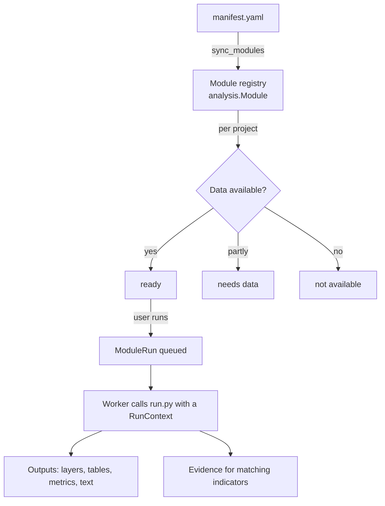

# Analysis modules

An analysis in GEIDA is a folder in `backend/analyses/<category>/<id>/` with a manifest
and a Python script (the platform calls each one a *module*). Adding an analysis means
adding a folder; the platform code does not change. The step-by-step guide is in
[Adding an analysis module](../development/adding-a-module.md).

```
backend/analyses/
├── categories.yaml          the eight catalogue categories
├── planned.yaml             analyses not built yet (listed as "Planned" per category and phase)
├── infrastructure/          one folder per category (its id from categories.yaml)
│   ├── area_profile/
│   │   ├── manifest.yaml    what the analysis is, needs and produces
│   │   └── run.py           def run(ctx): ...
│   ├── schools_inventory/
│   ├── health_inventory/
│   ├── buildings/
│   └── road_network/
├── terrain/                 raster analyses on the Copernicus DEM (each with METHOD.md and tests/)
│   ├── elevation_profile/
│   ├── slope/               (+ legend.yaml)
│   ├── aspect/              (+ legend.yaml)
│   ├── hillshade/           (+ legend.yaml)
│   └── contours/
├── land/                    land cover, vegetation, crops, forests (each with METHOD.md and tests/)
│   ├── land_cover/          WorldCover or Esri yearly land cover
│   ├── land_cover_change/   Esri yearly land cover, two years
│   ├── vegetation_indices/  Sentinel-2 composite (NDVI, EVI, SAVI, NDMI)
│   ├── biomass/             FAO WaPOR L2 biomass
│   ├── forest_loss/         Hansen Global Forest Change
│   └── field_boundaries/    Fields of The World
├── water/                   hydrology from the DEM (WhiteboxTools)
│   ├── stream_network/      streams, Strahler order, drainage density
│   ├── sub_basins/          sub-catchments and where streams leave the area
│   └── catchment/           catchment upstream of a point picked on the map, with its profile
├── people/                  population, settlements, access (each with METHOD.md and tests/)
│   ├── population/          GHSL population, density classes
│   ├── population_change/   GHSL population, two epochs
│   ├── settlements/         GHSL degree of urbanisation + OSM places
│   ├── service_access/      distance to OSM schools, clinics, markets, water points, roads
│   └── travel_time/         Malaria Atlas Project travel time to cities / health care
└── _parked/                 not loaded (folders starting with "_")
    └── terrain/terrain/      superseded by terrain/*; kept for its tests
```

The manifest's `category` must match its category folder, and analysis ids are unique
across categories (runs and evidence refer to them).

## Lifecycle



1. **Registration.** `sync_modules` (also run by `seed` and on every module list request)
   reads each `manifest.yaml` into the `Module` table.
2. **Availability.** For each project, the registry checks whether the module's inputs
   exist for that country and area, and labels it *ready*, *needs data* or
   *not available*.
3. **Recommendation.** Modules whose CRI codes appear in the project's Results Framework
   are listed first.
4. **Run.** The worker imports `run.py` and calls `run(ctx)`. The `RunContext` gives
   the module its parameters, the area, inputs fetched through the dataset registry,
   a logger and helpers to write outputs.
5. **Evidence.** Values the module reports for a CRI create *proposed* evidence on the
   matching project indicators.
6. **Working files.** Intermediate files go in `ctx.scratch()`, a temporary folder deleted when the run
   ends; only outputs stay in the run folder (`media/runs/<id>/`).
7. **Deleting.** The person who started a run, or a reviewer, can delete it once it has finished
   (`DELETE /api/analysis/runs/<id>/`, or several with `POST runs/delete/`). Its folder and any proposed or
   rejected evidence go with it; a run with accepted evidence can't be deleted until that evidence is
   rejected. The project's Activity log records each deletion.

## The manifest

```yaml
id: schools_inventory           # same as the folder name
version: 0.2.0                  # bump on every change to results
title: Schools in the area
question: Which schools are mapped, by level and unit?
status: curated                 # curated | experimental
category: infrastructure        # an id from categories.yaml
themes: [education]
phases: [preparation, implementation, completion]
cri:
  - {code: "9.3", role: verify}
inputs:
  required:
    - {name: schools, type: vector_point, default: osm_schools, label: Schools}
parameters:
  - {name: zone_level, type: choice, default: 2, label: Summarise by, choices: [...]}
outputs: [...]
citations: ["© OpenStreetMap contributors"]
```

The authoritative description of every field is `backend/analyses/README.md`.

## Modules in the catalogue

Every analysis, with its question, inputs, settings, workflow, method, outputs and limitations, is described
in [Analyses](../analyses/index.md). Those pages are generated from the manifests and `METHOD.md` files with
`python manage.py document_analyses`; run it after adding or changing an analysis.

The **parked** `terrain` module is superseded by the terrain analyses. `area_baseline` and
`school_access` were removed: Population, Slope, Land cover and Access to services replace
them. Past runs and evidence of removed modules remain viewable.

## Framework and toolkit

`backend/apps/analysis/` holds the framework and the shared code analyses use:

| Package | Purpose |
|---|---|
| `core/registry.py` | Finds `analyses/<category>/<id>/`, validates manifests, syncs the `Module` table, lists planned analyses |
| `core/runner.py` | The run context (`ctx`) and the run lifecycle: inputs, outputs, evidence, log, progress |
| `core/manifest.py` | The manifest schema (pydantic): fields, types, phases, unique names, limits, engines |
| `core/testing.py` | `AnalysisTestCase` for each analysis' own tests |
| `core/errors.py` | `AnalysisError` (also `ModuleError`): a failure message shown to the user |
| `core/envcheck.py` | Checks the worker can read rasters (rasterio, PROJ) and which engines (GDAL, GRASS, WhiteboxTools) are present |
| `data/` | The shared catalogue (`catalog.py`, also read by the Data Catalog); catalogue layers as analysis datasets clipped to the area (`cog.py`); dataset definitions and fetchers with local overrides (`registry.py`); derived-product cache (`cache.py`); OpenStreetMap extracts (`osm/`); land datasets outside the catalogue: Esri yearly land cover, Hansen forest change, Fields of The World (`land.py`); Sentinel-2 cloud-free composites (`sentinel2.py`); GHSL population, settlement and built-up tiles and Malaria Atlas Project travel-time maps (`people.py`) |
| `ops/terrain.py` | Slope, aspect and hillshade (Horn's 3×3 method, as gdaldem), classes, smoothing, contours (GDAL) |
| `ops/landcover.py` | Class maps: WorldCover and Esri class tables, legends, class areas, shares per unit, transition matrices |
| `ops/people.py` | Population helpers: people per class or band, population-weighted mean and median, distance to features on the grid |
| `ops/hydro.py` | Hydrology with WhiteboxTools: conditioned DEM, D8 flow and accumulation (cached per clip), streams with Strahler order, vector output as lon/lat |
| `engines/whitebox.py` | Runs WhiteboxTools tools (errors into the run), plain GeoTIFF inputs |
| `management/commands/document_analyses.py` | Writes `docs/analyses/` from the manifests and `METHOD.md` files (`--check` fails when out of date) |
| `ops/grid.py` | Rasters on a run grid in the area's UTM zone: read, write (COG), reproject, masks, statistics |
| `ops/vector.py` | shapely 2 helpers: point-in-polygon, nearest, lengths, areas in an equal-area projection centred on the area |
| `ops/raster.py` | Raster reading, masks, zones, pixel areas |
| `ops/inventory.py` | Standard inventory outputs (counts per unit, feature lists, map layers) |
| `render/preview.py` | Map previews: colour classes, downsample, PNG overlays with bounds |
| `render/legend.py` | Legends for raster results (ramp or classes): colours and legend rows |
