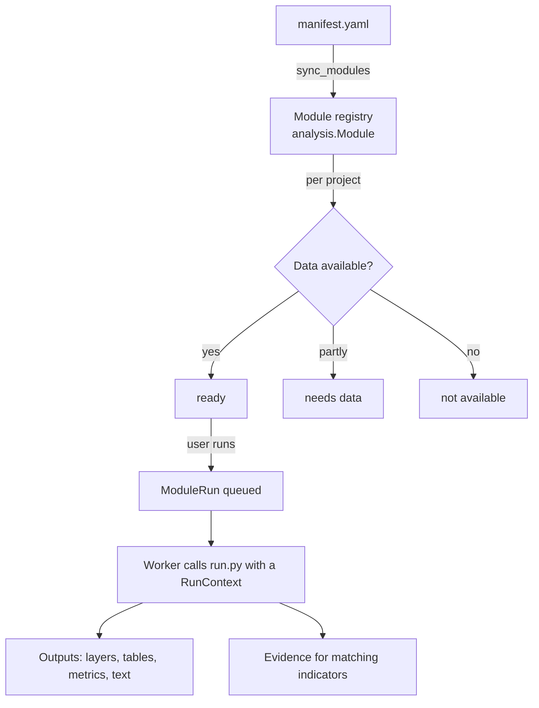

# Analysis modules

An analysis in GEIDA is a **module**: a folder in `backend/modules/` with a manifest and
a Python script. Adding an analysis means adding a folder; the platform code does not
change. The step-by-step guide is in
[Adding an analysis module](../development/adding-a-module.md).

```
backend/modules/
├── categories.yaml          the five catalogue categories
├── area_profile/
│   ├── manifest.yaml        what the module is, needs and produces
│   └── run.py               def run(ctx): ...
├── schools_inventory/
├── health_inventory/
├── buildings/
├── road_network/
└── _parked/                 not loaded (folders starting with "_")
    ├── area_baseline/
    ├── terrain/
    └── school_access/
```

## Lifecycle



1. **Registration.** `sync_modules` (also run by `seed` and on every module list request)
   reads each `manifest.yaml` into the `Module` table.
2. **Availability.** For each project, the registry checks whether the module's inputs
   exist for that country and area, and labels it *ready*, *needs data* or
   *not available*.
3. **Recommendation.** Modules whose CRI codes appear in the project's Results Framework
   are listed first.
4. **Run.** The worker imports `run.py` and calls `run(ctx)`. The `RunContext` gives
   the module its parameters, the area, inputs fetched through the dataset registry,
   a logger and helpers to write outputs.
5. **Evidence.** Values the module reports for a CRI create *proposed* evidence on the
   matching project indicators.

## The manifest

```yaml
id: schools_inventory           # same as the folder name
version: 0.2.0                  # bump on every change to results
title: Schools in the area
question: Which schools are mapped, by level and unit?
status: curated                 # curated | experimental
category: social                # an id from categories.yaml
themes: [education]
phases: [preparation, implementation, completion]
cri:
  - {code: "9.3", role: verify}
inputs:
  required:
    - {name: schools, type: vector_point, default: osm_schools, label: Schools}
parameters:
  - {name: zone_level, type: choice, default: 2, label: Summarise by, choices: [...]}
outputs: [...]
citations: ["© OpenStreetMap contributors"]
```

The authoritative description of every field is `backend/modules/README.md`.

## Modules in the catalogue

| Module | Category | Question | CRI |
|---|---|---|---|
| `area_profile` | Area profile | What is mapped in the project area? | — |
| `schools_inventory` | Social services | Which schools are mapped, by level and unit? | 9.3 (verify) |
| `health_inventory` | Social services | Which health facilities are mapped, by type and unit? | 8.1 (verify) |
| `buildings` | Built environment | How many buildings, what kind, how dense? | — |
| `road_network` | Infrastructure networks | Road length by class and surface, density per unit | 2.2 (verify) |

**Parked** modules (`area_baseline`, `terrain`, `school_access`) use rasters and will
return once population and terrain data are served from GEIDA's own storage. Their past
runs and evidence remain viewable.

## Shared helpers

| Helper | Purpose |
|---|---|
| `apps/analysis/osm/` | OpenStreetMap extracts, per-area cache, themed layers |
| `apps/analysis/vector.py` | shapely 2 helpers: point-in-polygon, nearest, lengths, areas in an equal-area projection centred on the area |
| `apps/analysis/inventory.py` | Standard inventory outputs (counts per unit, feature lists, map layers) |
| `apps/analysis/raster.py` | Raster reading and zonal statistics |
| `apps/analysis/datasets/registry.py` | Dataset definitions and fetchers, with local overrides |
