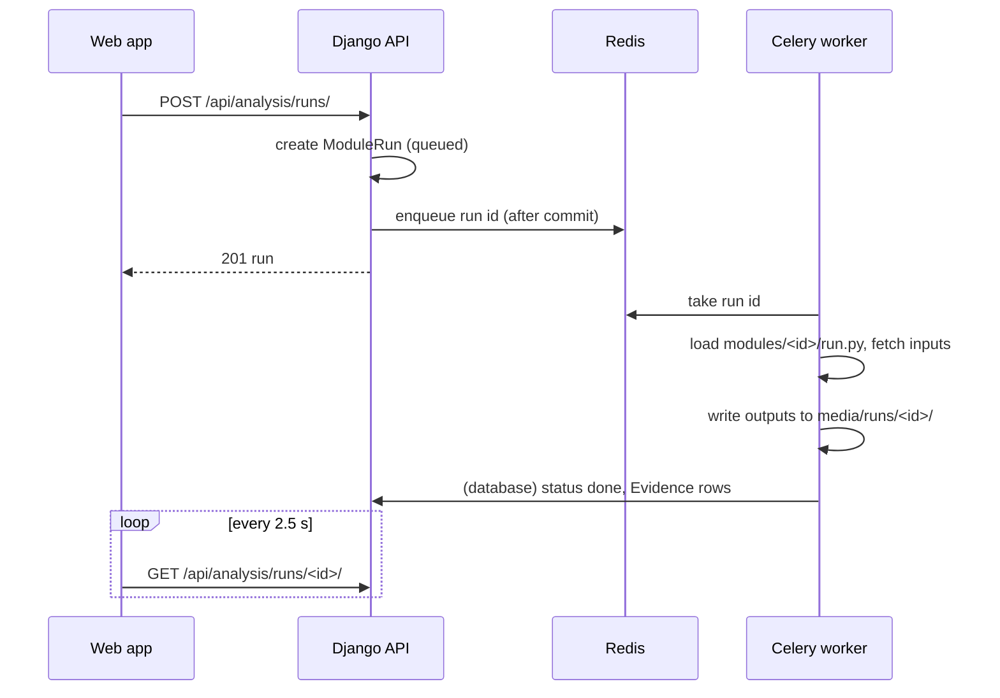

# Backend

The backend (`backend/`) is a Django project that serves only JSON under `/api/` and the
Django admin under `/admin/`. It never renders the web app's pages.

## Django apps

| App | URL prefix | Responsibility |
|---|---|---|
| `accounts` | `/api/auth/` | Session sign-in (email or username), registration with emailed code, password reset |
| `core` | `/api/site/` | Site content (navigation, sections), JSON error helpers, startup checks, the `seed` command |
| `geoportal` | `/api/geoportal/` | Layer catalogue and basemaps, raster tiles and GeoTIFF clips through TiTiler, saved areas |
| `boundaries` | `/api/boundaries/` | GADM administrative units (levels 0–3): search, GeoJSON, point lookup, union |
| `projects` | `/api/projects/` | Projects, areas, indicators, CRIs, documents, import, review workflow, project data-catalog layers |
| `analysis` | `/api/analysis/` | Module registry, runs, datasets, evidence; OSM and vector helpers |

Each app has the same shape: `models.py`, `views.py` (plain JSON views), `urls.py`,
`admin.py`, `tests*.py`, and `management/commands/` for data loaders.

## Settings

```
backend/config/
├── settings/
│   ├── __init__.py      imports development or production, chosen by DJANGO_ENV
│   ├── base.py          shared settings: apps, paths, Celery, email, data services
│   ├── development.py   SQLite + SpatiaLite, DEBUG on
│   └── production.py    PostgreSQL + PostGIS, secure cookies, secret key required
├── urls.py              /admin and /api/* routing
├── celery.py            Celery application
└── wsgi.py, asgi.py
```

`DJANGO_SETTINGS_MODULE` is always `config.settings`, for Gunicorn, Celery and
`manage.py` alike. Every value read from the environment is listed in
[Configuration](../setup/configuration.md).

## API reference

All responses are JSON. Writes need the `X-CSRFToken` header; `GET /api/auth/csrf/`
sets the cookie. Unknown `/api/` paths return a JSON 404.

| Area | Endpoints (relative to the prefix) |
|---|---|
| Auth `/api/auth/` | `GET csrf/` · `GET me/` · `POST sign-in/` · `POST sign-out/` · `POST register/` · `GET,POST verify/` · `POST verify/resend/` · `POST password-reset/` · `GET,POST password-reset/<uid>/<token>/` |
| Site `/api/site/` | `GET /` |
| Data Catalog `/api/geoportal/` | `GET config/` · `GET basemaps/` · `GET layers/<id>/tiles/?year=` · `POST layers/<id>/clip/` · `GET,POST areas/` · `PATCH,DELETE areas/<id>/` |
| Boundaries `/api/boundaries/` | `GET units/?iso3=&level=&parent=&q=` · `GET units/geojson/` · `GET units/<gid>/` · `GET at/?lon=&lat=` · `GET world/` · `POST union/` |
| Projects `/api/projects/` | `GET,POST /` · `GET meta/` · `GET cri/?q=` · `POST area/preview/` · `GET import/template/` · `POST import/preview/` · `POST import/commit/` · `GET,PATCH,DELETE <code>/` · `PUT <code>/area/` · `PUT <code>/indicators/` · `PUT <code>/documents/` · `POST <code>/submit/`, `return/`, `publish/` |
| Project data layers | `GET <code>/satellite/` · `GET <code>/satellite/<id>/tiles/?year=&cmap=&range=` · `GET <code>/satellite/<id>/xyz/<z>/<x>/<y>.png` · `GET <code>/satellite/<id>/download/` |
| Analysis `/api/analysis/` | `GET datasets/` · `GET modules/?project=` · `GET,POST runs/` · `GET runs/<id>/` · `POST runs/<id>/cancel/` · `GET runs/<id>/files/<name>` · `GET evidence/` · `POST evidence/<id>/accept/`, `reject/` |

## Background work



- A run has a hard time limit (`ANALYSIS_TIME_LIMIT`, default one hour).
- If Redis restarts, runs left in *queued* can be re-queued with
  `python manage.py requeue_runs` (add `--stale N` to include runs *running* for more
  than N minutes).
- With `CELERY_TASK_ALWAYS_EAGER=true`, runs execute inside the request, with no Redis
  or worker. Use this only on a development machine.

## Management commands

| Command | What it does |
|---|---|
| `seed [--boundaries] [--countries UGA,AZE]` | Load all reference data; idempotent, run on every deploy |
| `load_cri [csv]` | CRI library only |
| `sync_modules` | Register the modules found in `backend/modules/` |
| `load_admin_units [--countries] [--levels] [--replace]` | GADM administrative units only |
| `run_worker [-c N] [--noreload]` | Celery worker; reloads on code change when `DEBUG` is on |
| `requeue_runs [--stale N]` | Re-queue runs stuck in *queued* (or *running* for over N minutes) |

## Conventions

- Views return `JsonResponse`; raise `apps.core.api.BadRequest` for a 400 and parse input
  with `json_body(request)`.
- Every schema change has a migration. Changes to reference tables go through `seed`,
  not data migrations.
- Python follows PEP 8 with 120-character lines; modules and public functions have
  docstrings.
