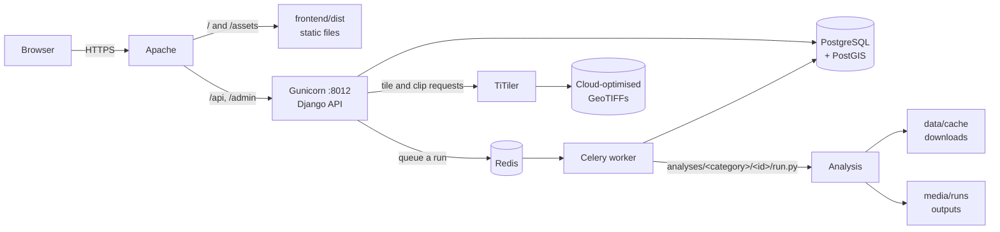
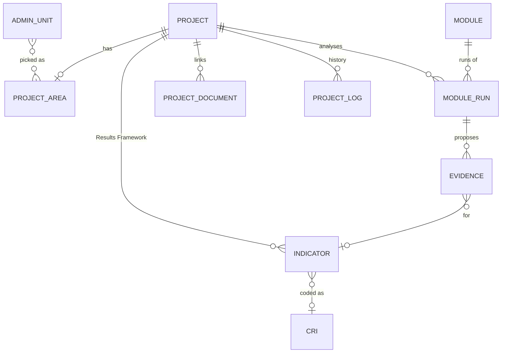

# Architecture overview

GEIDA is a React single-page application on top of a Django JSON API, with a Celery
worker that runs geospatial analyses outside the web request. It is designed to move to
IsDB hosting: it runs on a single server built from open-source components, and each
external dependency (the tile server, open-data hosts) can be replaced by a copy on
IsDB's servers.

## Components

| Component | Technology | Responsibility |
|---|---|---|
| **Web app** | React 19, TypeScript, Vite 8, MapLibre GL, OpenLayers (Data Catalog), GeoLibre (Analytics) | Every screen the user sees |
| **API** | Django 6 with GeoDjango, served by Gunicorn | Accounts, projects, CRIs, boundaries, data catalog, analysis orchestration |
| **Worker** | Celery 5 with a Redis broker | Runs analysis modules in the background |
| **Database** | PostgreSQL + PostGIS (development and production) | Projects, geometries, administrative units, runs, evidence |
| **Analysis modules** | Python: GDAL, rasterio, shapely 2, NumPy | One folder per analysis; a manifest declares inputs, CRIs and outputs |
| **Raster service** | TiTiler (external, `TITILER_URL`) | Draws map tiles from cloud-optimised GeoTIFFs and cuts GeoTIFF downloads |
| **Web server** | Apache 2 | HTTPS, serves the built web app, proxies `/api` and `/admin` to Gunicorn |

## How a request flows



- The browser always sees **one origin**. In development Vite (port 5173) proxies `/api`
  and `/admin` to Django (port 8000); in production Apache does the same. The session
  cookie and the CSRF token therefore work without cross-origin configuration.
- **Long work never runs in a web request.** Creating a run only stores a `ModuleRun`
  row and queues a task; the browser polls the run's status every 2.5 seconds.
- **Raster tiles** are drawn by TiTiler straight from files hosted by their producers
  (FAO, ESA, Copernicus). GEIDA's API adds the area-of-influence mask for project maps.

## Core domain



- A **project** belongs to one country and has one **area of influence** (a
  MultiPolygon in WGS 84).
- Its **Results Framework** is a list of **indicators**, each optionally coded with a
  **CRI** from the library.
- A **module run** executes one module for one project and phase. Its outputs (layers,
  tables, text) are files under `media/runs/<id>/`.
- **Evidence** rows are created when a run's result matches a project indicator, with
  status *proposed*, then *accepted* or *rejected* by a person.

## Repository layout

```
isdb_geida/
├── backend/        Django API, analysis modules, seed data        → Backend
├── frontend/       React app and the vendored GeoLibre workspace   → Frontend
├── docs/           this documentation (MkDocs), specs, decision log
├── deploy/         Apache virtual host, systemd units, release script
├── mkdocs.yml      documentation site configuration
├── Makefile        developer shortcuts (`make help`)
├── local/          personal notes, git-ignored
└── cred/           credentials, git-ignored
```

## Environments

| | Development | Production |
|---|---|---|
| Settings module | `config/settings/development.py` | `config/settings/production.py` |
| Database | PostgreSQL + PostGIS (local, database `geida`) | PostgreSQL + PostGIS |
| Web | Vite dev server :5173, proxy to Django :8000 | Apache + Gunicorn :8012 |
| Worker | `manage.py run_worker` (reloads on code change) or inline (eager) mode | `geida-worker` systemd service |
| Email | Printed in the Django console | SMTP |

`DJANGO_ENV` in `backend/.env` selects the settings module. Nothing else changes between
environments; see [Configuration](../setup/configuration.md).

## Design decisions

The reasons behind the main choices (Django + React, modules as plug-ins,
cloud-optimised GeoTIFFs with TiTiler, OpenStreetMap from Geofabrik, CRIs as data) are recorded in the
decision log (`docs/decisions.md` in the repository). Read it before changing any of them.
