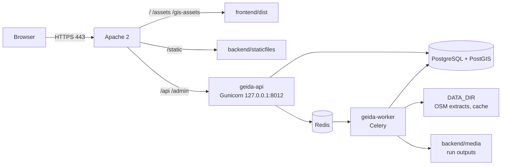

# Deployment overview

GEIDA runs on a single Linux server. Apache serves the built web app and proxies the API
to Gunicorn; a Celery worker runs analyses; PostgreSQL with PostGIS stores the data;
Redis queues the runs.

## Server requirements

| Resource | Minimum | Recommended |
|---|---|---|
| OS | Ubuntu 22.04 LTS | Ubuntu 24.04 LTS |
| CPU | 2 cores | 4 cores |
| RAM | 8 GB | 16 GB (the frontend build alone needs about 6 GB) |
| Disk | 40 GB | 100 GB (GADM 4.5 GB, OSM extracts, run outputs, database) |
| Network | Outbound HTTPS to the data hosts listed in [Prerequisites](../setup/index.md#network-access) | |
| DNS | A record for the site (today `geida.terrawatch.net`) | |

## Files in `deploy/`

| File | Purpose |
|---|---|
| `deploy/apache/geida.conf` | Apache virtual host: HTTPS, single-page-app fallback, cache headers, proxy to Gunicorn |
| `deploy/systemd/geida-api.service` | Gunicorn service for the Django API (3 workers, port 8012) |
| `deploy/systemd/geida-worker.service` | Celery worker service for analysis runs (2 processes) |
| `deploy/scripts/deploy.sh` | Release script: pull, update dependencies, migrate, seed, build, restart |

The files assume user **`ecduser`**, the repository at
**`/home/ecduser/isdb_geida`** and conda at **`/home/ecduser/miniconda3`**.
Adjust them before copying them onto a different server.

## Pages in this section

| Page | When |
|---|---|
| [First-time installation](first-install.md) | Setting up a new server |
| [Releasing an update](releases.md) | Every release to an existing server |
| [Operations](operations.md) | Day-to-day: services, logs, backups, monitoring |

!!! warning "Production servers"
    Make changes on a shared server only with the team's agreement, and never delete data
    folders (`REFERENCE_DATA_DIR`, `DATA_DIR`, `backend/media`) or the database without a backup.
