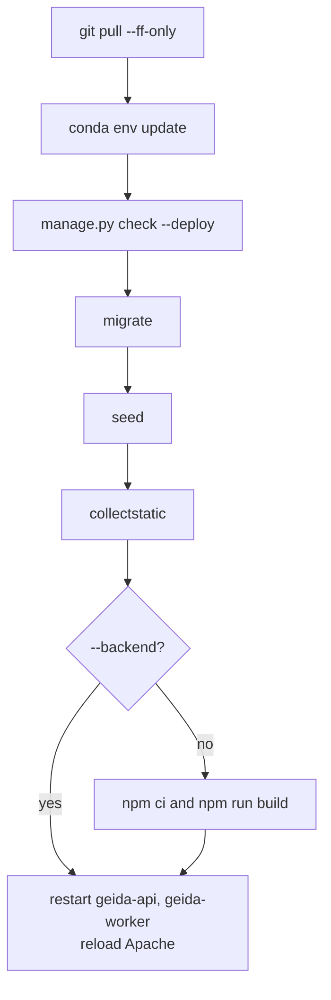

# Releasing an update

Every change reaches the server the same way: commit to the release branch, then run the
release script on the server.

## Before the release

On a development machine:

- [ ] Backend tests pass: `cd backend && python manage.py test`
- [ ] No missing migrations: `python manage.py makemigrations --check --dry-run`
- [ ] Frontend type-check passes: `cd frontend && npm run typecheck`
- [ ] The [Changelog](../changelog.md) has an entry for the release, under its date
- [ ] If administrators must do anything by hand (new `.env` value, new dataset, data
      migration), an [Update note](../updates/index.md) explains it
- [ ] Changes are committed and pushed

## Run the release

On the server, as the application user:

```bash
cd ~/geida_platform_react
./deploy/scripts/deploy.sh               # backend and frontend
./deploy/scripts/deploy.sh --backend     # backend only (skips the frontend build)
```

The script, in order:



It stops at the first failing step (`set -euo pipefail`), so a broken migration never
leaves services restarted on half-updated code. The worker waits up to five minutes for a
running analysis to finish before it restarts.

## After the release

```bash
systemctl status geida-api geida-worker --no-pager
curl -sI https://geida.terrawatch.net/api/site/ | head -1      # HTTP/2 200
journalctl -u geida-api -n 50 --no-pager
```

Open the site, hard-refresh (the HTML is never cached; hashed assets are), and check the
pages the release touched.

## Rolling back

```bash
cd ~/geida_platform_react
git log --oneline -5                      # find the previous release
git checkout <previous-commit>
./deploy/scripts/deploy.sh                # rebuild and restart on the old code
```

!!! danger "Migrations"
    If the release applied a migration, rolling back the code does not roll back the
    database. Restore the backup taken before the release, or reverse the migration with
    `python manage.py migrate <app> <previous_migration>` **before** checking out the old
    code. Take a database backup before any release that contains migrations
    ([Operations](operations.md#backups)).

## Versioning

Releases are identified by date (`YYYY-MM-DD`) in the [Changelog](../changelog.md), and by
the git commit the script prints at the end (`Deployed <hash>`). Tag releases in git with
the same date: `git tag release-2026-11-09 && git push --tags`.
