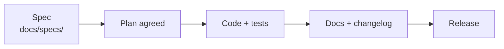

# Development workflow

## How work is done

1. **Spec first.** Every feature starts as `docs/specs/<feature>.md`, one or two pages:
    - **Purpose**: the user problem and the project-cycle stage it serves (PCN … PPER).
    - **User steps**: what the user does, screen by screen.
    - **Inputs and outputs**: exact field, variable and endpoint names.
    - **Acceptance tests**: concrete values or behaviours that prove it works.
2. **Plan agreed** with the product owner before code is written.
3. **Code with tests** in the places listed below.
4. **Document**: update the affected pages here, add a [Changelog](../changelog.md)
   entry, and an [Update note](../updates/index.md) if administrators must act.
5. **Record decisions** that IsDB IT will ask about (hosting, authentication, data
   sources, licences) in the decision log, `docs/decisions.md` (kept in the
   repository, not published).

## Where code goes

| Change | Location |
|---|---|
| New backend feature | A Django app in `backend/apps/<name>/` (models, views, urls, tests) |
| New analysis | A folder in `backend/analyses/<category>/<id>/`; no platform code changes ([guide](adding-a-module.md)) |
| Reference data a fresh database needs | A folder in `REFERENCE_DATA_DIR` plus an entry in its `catalog.json` ([guide](../setup/reference-data.md)) |
| Seed data | `REFERENCE_DATA_DIR/catalog.json` (outside the repository); `manage.py seed`, which also registers the analyses. Never commit rasters or GADM |
| New page or feature in the web app | `frontend/src/features/<name>/` |
| Reusable UI pieces | `frontend/src/shared/` |
| Routes and application shell | `frontend/src/app/` |
| A basemap or catalogue layer | `backend/apps/analysis/data/catalog.py` (also makes COG layers available to analyses) |

## Rules

- Never change the database schema without a migration; run
  `python manage.py makemigrations --check --dry-run` before finishing.
- Never hard-code CRI codes, module ids or country lists; they are data.
- Never write a value into a project's Results Framework automatically; evidence stays
  evidence until a person accepts it.
- Never commit secrets: `backend/.env`, `cred/*`, keys. `local/` is personal and ignored.
- Keep changes inside `frontend/gis/` (GeoLibre) small and limited to what a feature needs.
- An analysis runs only where its data allow; say so in the interface when it can't.
- Shared settings go in `config/settings/base.py`; environment differences in
  `development.py` or `production.py`.

## Code style

| | Convention |
|---|---|
| Python | PEP 8, 120-character lines, docstrings on modules and public functions |
| TypeScript | `strict`, no unused locals; `@/` imports across features, relative inside one |
| CSS | Design tokens in `shared/styles/geida.css`; feature styles beside the feature |
| Commits | Imperative summary line ("Add road_network module"), body explaining why |
| Formatting | `.editorconfig` at the repository root |

## Branches and releases

- `main` is the release branch; the server deploys from it.
- Work on short-lived branches (`feature/<name>`, `fix/<name>`) and merge when tests pass.
- Releases are dated; see [Releasing an update](../deploy/releases.md).
