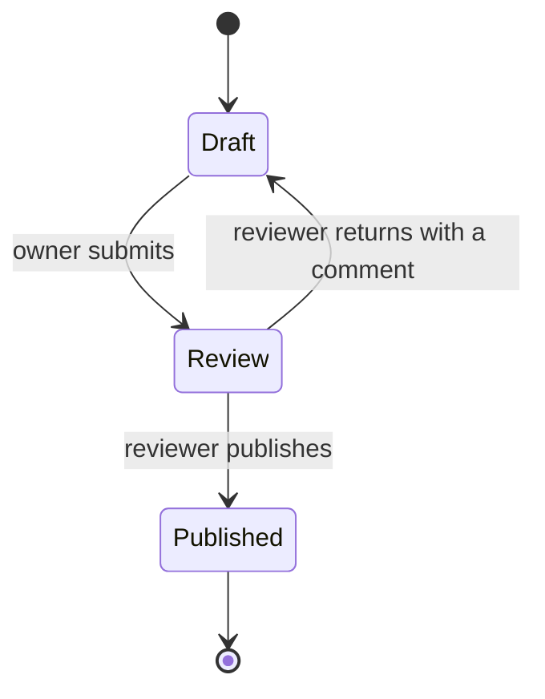

# Features

This page describes what each part of GEIDA does today. The [Changelog](../changelog.md)
records when each feature arrived.

## Projects

### Onboarding

A project can enter GEIDA three ways:

| Route | How | Use when |
|---|---|---|
| **Wizard** | `/projects/new`, step by step | One project at a time |
| **Bulk import** | `/projects/import`: download the Excel template, fill it, upload, preview row errors, commit | Many projects from a portfolio list |
| **Submission form** | Upload IsDB's Project Data Submission Form | The project team already filled the form |

The wizard collects:

1. **Identity**: project code, title, country, sector, cycle stage, dates, regional hub.
2. **Area of influence**, by one of four methods: upload a file (GeoJSON, KML/KMZ,
   GeoPackage, GML or a zipped Shapefile), draw a polygon, pick administrative units, or place a
   point with a buffer. Geometries are validated, repaired where possible, reprojected to
   WGS 84 and their area computed. Problems are reported, never silently fixed.
3. **Themes and components**.
4. **Results Framework**: indicators at impact, outcome and output level, each with an
   optional CRI code, baseline, target and geospatial role.
5. **Documents**: links to the project's documents (for example on SharePoint).

A duplicate project code updates the existing record instead of creating a second one.

### Review

- **Draft**: visible to the owner and reviewers only.
- **Under review**: waiting in the review queue (`/projects/review`).
- **Published**: visible to everyone, including visitors who are not signed in.

Every action is recorded in the project's Activity log.

## Project workspace

`/projects/<code>` combines one persistent map with a side panel chosen from a rail. The top
of the side panel always shows the project's code, status, title and the workflow actions
(edit, submit, return, publish, delete) the user is allowed:

| Tab | What it shows |
|---|---|
| **Overview** | Key facts, area of influence, project details |
| **Results** | The Results Framework and the evidence attached to each indicator |
| **Analyses** | First the project phase (preparation, implementation, completion), then two views. **Analysis modules**: the catalogue for the current phase, grouped by category, with past runs and their outputs. **Data layers**: the Data Catalog's rasters in their sections (Climate and water, Vegetation and land, Crop water productivity, Terrain, Population and imagery), cut to the area of influence, each with its period and a GeoTIFF download. Each phase lists its own modules and data layers; a layer can belong to several phases |
| **Evidence** | Values proposed by analyses, to accept or reject |
| **Documents** | Links to the project's documents |
| **Activity** | The history of the project record |

The map has a Layers panel listing every layer on it (run outputs, data layers, area of
influence, basemap). Each has a legend and display settings: opacity for all; palette
(optionally reversed) and value range for continuous data layers, redrawn by the tile
server; colour or palette, size and outline for analysis outputs; outline and fill for the
area; basemap on or off and the map background colour. Settings are kept per project in
the browser, and the map export's legend and colour bar follow them. The map also has a
basemap picker shared with the rest of the platform, and a **map export** button.

### Map export

The map export opens a layout editor: a page on which maps, legends, scale bars, north
arrows, colour bars, text (with fields such as the project title), pictures (the IsDB
logo) and shapes are placed and styled freely. Overview maps show the project's country
or its province/region (from the administrative boundaries) with the boundary drawn and
the main map's extent marked, or a globe locator with the country highlighted. Templates give a starting layout; your own
layouts can be saved as templates (kept in the browser, up to 20). Output is SVG, PNG or PDF at up to 600 dpi.

## Analyses

An analysis is a **module**: a folder with a manifest and a Python script (see
[Analysis modules](../architecture/analysis-modules.md)). Modules are grouped in five
categories:

| Category | Question | Modules today |
|---|---|---|
| Area profile | What is mapped in the project area? | `area_profile` |
| Social services | Which schools, clinics and community facilities exist? | `schools_inventory`, `health_inventory` |
| Neighbourhood and access | Who lives near or far from services and roads? | planned |
| Built environment | How many buildings, how dense, what kind? | `buildings` |
| Infrastructure networks | What roads, water and power assets exist? | `road_network` |

Each module is marked **ready**, **needs data** or **not available** for a project, so
staff see before running it whether the data exist. Runs are queued and executed by a
background worker; the page updates while a run is in progress. Outputs are map layers,
tables (downloadable as CSV), metrics and a summary paragraph.

## Data Catalog (Geo-Portal)

`/geoportal` is a full-screen map for browsing data without a project:

- **Layers**: climate and water (precipitation, evapotranspiration, surface water),
  vegetation and land (biomass, land cover), terrain (elevation, slope, hillshade),
  boundaries, and view-only layers from open map services.
- **Areas**: draw or upload an area, save it, and download a layer clipped to it as a
  GeoTIFF.
- **Toolbox**: a curated set of processing tools (terrain, hydrology, raster, vector)
  run in the browser.

## Analytics

`/analytics` is the full GIS workspace (GeoLibre): add data from files and services,
style layers, run processing tools and models, and print maps. It is intended for
analysts and trainers, and can be limited to them (see [Users and roles](roles.md)).

## Accounts

- Registration with an emailed verification code.
- Sign-in with email or username; password reset by email.
- Roles are assigned by administrators in `/admin` (see [Users and roles](roles.md)).
