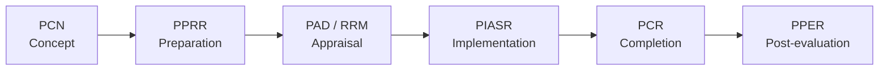
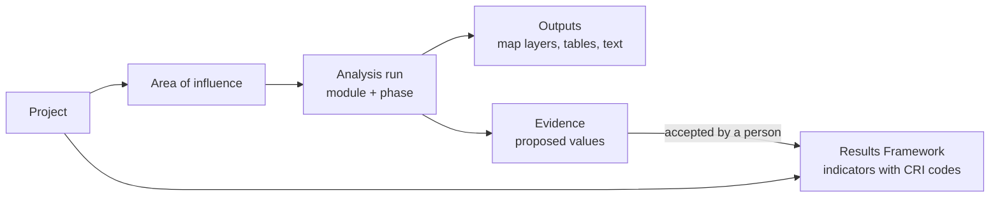

# The IsDB project cycle

GEIDA is organised around the IsDB project cycle. Each stage produces a document
(an *instrument*), and each instrument needs facts about the project area.

## Stages and GEIDA phases

GEIDA groups the six stages into three working phases. The Analyses tab of a project
opens on the phase that matches the project's current stage.

| IsDB stage | Stage | GEIDA phase | Typical questions |
|---|---|---|---|
| PCN | Project Concept Note | Preparation | What is in the area? Who lives there? What services exist? |
| PPRR | Project preparation | Preparation | Baselines for the indicators; site constraints |
| PAD / RRM | Appraisal | Preparation | Final baselines and targets |
| PIASR | Implementation | Implementation | Progress since baseline; verification of outputs |
| PCR | Completion | Completion | Achieved values against targets |
| PPER | Post-evaluation | Completion | Lasting outcomes |

The stage list and its labels are defined in `backend/apps/projects/choices.py` (`STAGES`),
and the stage-to-phase mapping in the frontend (`STAGE_PHASE` in
`features/projects/workspace/data.ts`).

## How evidence flows

1. A project is registered with its **area of influence** (drawn, uploaded, picked from
   administrative units, or a point with a buffer) and its **Results Framework**.
2. Each indicator in the Results Framework can carry an IsDB **Core Result Indicator**
   (CRI) code. GEIDA's CRI library holds the 77 CRIs of the 2025 list.
3. **Analysis modules** declare which CRIs they inform and in what role (see below).
   GEIDA recommends modules whose CRIs match the project's indicators.
4. A finished run proposes **evidence** for matching indicators. A reviewer accepts or
   rejects each value. Accepted evidence is shown against the indicator; it never
   overwrites the baseline or target on its own.

## Geospatial roles

Each module states how its result relates to an indicator:

| Role | Meaning | Example |
|---|---|---|
| **Measure** | The value is the indicator, measured from data | Irrigated area in hectares |
| **Estimate** | A modelled approximation of the indicator | Buildings within 5 km of a school as a proxy for people served |
| **Verify** | Independent confirmation of a reported value | Schools mapped in OpenStreetMap against the number the project reports |
| **Context** | Background that explains the indicator | Rainfall, terrain |
| **Recorded** | Entered by the project, not computed | A value from a supervision mission |
