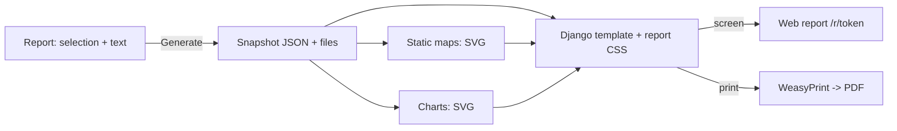

# Project reports: PDF and web report from a project's analyses

Status: built (16 Nov 2026): steps 1–5 of §10 and most of step 6. User guide: [Features → Project
reports](../introduction/features.md#project-reports). Decisions taken: static SVG maps in both outputs; share
links open without signing in, with an optional end date and revoke; one standard template; the summary is
written by the user, with one line per analysis added; Light basemap by default (Satellite per report); A4
portrait.

What changed from the plan while building:
- A version keeps its web page as one self-contained HTML file (maps, fonts and logos embedded) next to its PDF;
  the database keeps the snapshot without pictures.
- Shared links are served under `/api/reports/shared/<token>/` (no separate `/r/` route).
- Maps: one composed basemap image per map (Esri tiles, cached in `DATA_DIR/cache/report_tiles`), raster
  previews warped to Web Mercator, vectors simplified to the map's pixel size.
- Interactive maps in the web report: built (Leaflet embedded in the page; static SVG kept as fallback and for
  the PDF).
- Not done yet: sortable tables in the web report, public reports on published projects,
  Toolbox results and an evidence section, phase presets, a "used in a report" note when deleting a run.

## 1. Goal

From a project's workspace, a user picks the analyses they ran, adds their own text, and generates a
report they can share: a **PDF** (print and attach to IsDB documents) and a **web report** (a link that opens
a dashboard-style page). Both come from the same content and the same design, look professional, and stay
correct even if runs are deleted later.

## 2. What a report contains

| # | Section | Content | Source |
|---|---|---|---|
| 1 | **Cover** | Report title and subtitle, project code and title, country, sector, stage (PCN, PPRR…), date, author, IsDB and GEIDA logos, a map of the area of influence | Project record, area |
| 2 | **Summary** | The author's own text, then one line per analysis (each run's summary) and the key figures in cards | User text, run summaries and metrics |
| 3 | **Project** | Key facts (dates, OTL, hub, components); area of influence (size, method, admin units, map); Results Framework (indicators with baseline, target and accepted GEIDA evidence) | Project record, indicators, evidence |
| 4 | **One section per analysis** | Question; key figures (metric cards); map(s) with legend, scale bar and north arrow; charts from class or band tables; selected tables; the run's summary; short method; data sources; run number, date, settings | Run outputs, manifest, METHOD.md |
| 5 | **Toolbox results** (optional) | Chosen Toolbox outputs as maps or tables, with the tool and settings | Tool runs |
| 6 | **Evidence** | Evidence proposed and accepted for the Results Framework, with role, value, date of data, reviewer | Evidence records |
| 7 | **Annex** | Methods in full (METHOD.md), data sources and licences, glossary, disclaimer, how the report was made (GEIDA version, run ids) | Manifests, METHOD.md |

The user chooses which analyses go in, and for each analysis which outputs (figures, each map, each
table, the method), in what order. Sections 1, 3 and 7 can be switched off.

## 3. User flow

1. **Project → Reports** (a new tab in the workspace) lists the project's reports: title, status, last
   generated, author, and the share state.
2. **New report**:
   - title, subtitle, phase (preparation / implementation / completion: decides the default content and the
     instrument shown, e.g. "Annex to the PPRR");
   - **pick runs**: the finished analysis runs of the project, grouped by category, newest first; and
     optionally Toolbox results;
   - for each run, tick its outputs (defaults: figures, the first map, the first table, the summary);
   - write the summary and, optionally, a note per section (e.g. "what this means for the project");
   - drag sections to reorder.
3. **Preview**: the web report, live, as it will look.
4. **Generate**: GEIDA freezes the content (§4), builds the PDF and the web page, and keeps them as a
   numbered **version** (v1, v2…).
5. **Share**:
   - **Download PDF**;
   - **Copy link**: a share link (a long random token) that opens the web report without signing in;
   - links can expire (optional date) and can be revoked;
   - for published projects, a report can also be marked **public** (listed on the project's public page).
6. **Edit and regenerate**: changing the selection or text and generating again makes a new version; the
   share link can point to "latest" or stay on a version.

## 4. Snapshots: reports don't break

Runs can be deleted and projects change, so generating a report **copies what it shows**:
- the run outputs it uses (metrics, tables, summary, map previews, vector layers, legends), the manifest
  title, question, method text and citations;
- the project facts, area and indicators as they are at that moment;
- into `media/reports/<report>/<version>/` (a JSON snapshot plus the images), with the PDF.

A report version never changes after it is generated. Deleting a run doesn't affect reports made from it;
the delete confirmation says when a run is used in a report. Size: a typical version is a few MB (map
images and the PDF).

## 5. How it is built

- **One template, two outputs.** A Django template renders the report HTML from the snapshot. The same HTML
  and one stylesheet serve the web page (`@media screen`) and the PDF (`@media print`, `@page` rules), so they
  can't drift apart. WeasyPrint turns the print version into PDF (page size A4, margins, running headers and
  footers, page numbers, a table of contents with page numbers).
- **Maps as SVG**, drawn on the server for both outputs:
  - basemap tiles (Esri Light or Satellite, chosen per report) fetched for the map's extent and placed as
    images;
  - the area of influence outline;
  - raster results as their existing PNG previews, placed at their bounds;
  - vector results drawn as SVG paths with their styles (colours, classes, line widths);
  - legend, scale bar, north arrow, attribution, figure number and caption.
  SVG keeps lines and text sharp in print, and needs no imaging library (WeasyPrint renders it).
- **Charts as SVG** from tables that have a label and a share or area column (land cover classes, slope classes,
  distance bands, suitability classes…): horizontal bars or a stacked bar, in the theme's colours, with values.
- **Web report** (`/r/<token>`, and inside the workspace for members): the same sections in a dashboard layout:
  a sticky table of contents, metric cards, maps you can open full-screen with the interactive project map
  (layers of that run), tables you can sort and download as CSV, and a **Download PDF** button.
- **Generation runs in the background** (the analysis queue): a report with ten analyses and ten maps takes
  roughly 20–60 s (tile downloads for maps are most of it; tiles are cached).

## 6. Design theme

One theme for web and PDF, defined as CSS variables, matching GEIDA:

| Element | Choice |
|---|---|
| Colours | Teal `#0B3B47` (headings, cover band), gold `#C9A25B` (accents, rules), green `#2F8F4E` (positive values), ink `#121114`, sand `#F5F5F5` (cards), category colours for section markers |
| Type | Outfit (open licence), embedded in the PDF; 10.5 pt body, 22 / 15 / 12 pt headings; tabular numbers in tables and cards |
| Page (PDF) | A4 portrait, 18 mm margins; cover page full-bleed teal band with the area map; running header (project code, report title), footer (page x of y, "Generated with GEIDA · IsDB", date) |
| Components | Metric cards (value, unit, label, source); figure with number and caption ("Figure 3. Slope classes, Copernicus DEM 30 m"); tables with zebra rows and units in headers; callout boxes for the author's notes; evidence badges (proposed / accepted); method and data boxes; citations as footnote-style references |
| Section markers | Each analysis section starts with its category icon and colour (terrain, water, land, people, infrastructure, planning) |
| Accessibility | Tagged PDF (WeasyPrint `pdf_variant="pdf/ua-1"` where supported), alt text for maps and charts, sufficient contrast |

The theme lives in one file (`backend/apps/reports/static/reports/report.css`), so IsDB can adjust it once.

## 7. Data model

| Table | Fields |
|---|---|
| `Report` | project, title, subtitle, phase, author (user), created, updated, `content` (JSON: sections in order, selected runs and outputs, texts, options such as basemap and annexes), `share_token`, `share_expires`, `public` (bool) |
| `ReportVersion` | report, number, created, created_by, status (queued / building / done / failed), error, `snapshot` (JSON), `pdf` path, size, page count |

Permissions: as for analyses: the project's owner, editors and reviewers create and generate reports;
anyone who can open the project sees them; the author or a reviewer deletes a report, shares or revokes it.
Share links show one report only (no project data beyond it).

## 8. API

| Endpoint | Purpose |
|---|---|
| `GET,POST /api/reports/<code>/` | List / create reports |
| `GET,PATCH,DELETE /api/reports/<id>/` | Read, edit content, delete |
| `GET /api/reports/<id>/preview/` | Render the current content as HTML (not frozen) |
| `POST /api/reports/<id>/generate/` | Freeze and build a new version (queued) |
| `GET /api/reports/<id>/versions/` | Versions with status, PDF size, pages |
| `GET /api/reports/versions/<id>/pdf` | Download the PDF |
| `POST /api/reports/<id>/share/` | Create or change the share link (expiry, public) / revoke |
| `GET /r/<token>` | The shared web report (no sign-in) and `/r/<token>.pdf` |

## 9. Dependencies and server

- `weasyprint` (BSD) from conda-forge with Pango, HarfBuzz and fonts (`environment.yml`); cairo is already in
  the environment.
- Outfit font files committed under `backend/apps/reports/static/reports/fonts/` (SIL Open Font Licence).
- No new imaging library: maps and charts are SVG.
- Server: install the environment changes and run `migrate` (when you ask).

## 10. Build order

| Step | Content | Size |
|---|---|---|
| 1 | `reports` app: models, snapshot builder, the Django template and theme CSS, WeasyPrint PDF; a first report with cover, project and analysis sections (metrics, tables, summaries) | M |
| 2 | SVG maps (basemap tiles, area, rasters, vectors, legend, scale bar, north arrow) and SVG charts | M |
| 3 | Reports tab: list, report editor (pick runs and outputs, texts, order), live preview | M |
| 4 | Generate in the background, versions, PDF download | S |
| 5 | Sharing: link with expiry, revoke, public; the shared web report page with interactive maps and CSV downloads | M |
| 6 | Annex (methods, data, licences), evidence section, Toolbox results, table of contents with page numbers; tests and docs | M |

## 11. Decisions needed

1. **Web report maps**: static SVG maps (same as the PDF) with a button to open the interactive map
   (recommended), or interactive maps inline everywhere.
2. **Share links**: anyone with the link (recommended, with optional expiry and revoke), or signed-in users only.
3. **Phase templates**: one standard report now (recommended), with phase-specific presets later (e.g. "PPRR
   annex", "PIASR progress", "PCR completion").
4. **Summary text**: written by the user, with GEIDA pre-filling one line per analysis (recommended); an AI
   draft could come later.
5. **Basemap in printed maps**: Light (clean in print, recommended default) or Satellite, chosen per report.
6. **Paper size**: A4 portrait (recommended), with A4 landscape for wide maps later.
