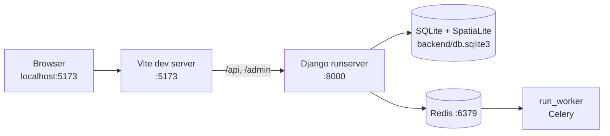

# Local development

By the end of this page you will have the API on port 8000, the analysis worker running,
and the web app on port 5173.



## 1. Get the code

```bash
git clone <repository-url> isdb_geida
cd isdb_geida
```

## 2. Create the Python environment

```bash
cd backend
conda env create -f environment.yml     # creates the "geida" environment (5–10 minutes)
conda activate geida
```

The environment contains Python 3.12, GDAL, PROJ, GEOS, SpatiaLite, rasterio, shapely 2
and the packages in `requirements.txt` (Django, Celery, Gunicorn, …).

After someone changes `environment.yml` or `requirements.txt`, update with:

```bash
conda env update -f environment.yml --prune
```

## 3. Configure

```bash
cp .env.example .env
```

The defaults work for development: SQLite database, emails printed in the console,
Redis on `localhost:6379`. Every setting is explained in [Configuration](configuration.md).

## 4. Create the database and load reference data

```bash
python manage.py migrate                 # builds backend/db.sqlite3
python manage.py seed                    # CRI library, analysis modules
python manage.py createsuperuser         # your admin account
```

Administrative boundaries are optional for a first run but needed for the "pick
administrative units" area method and for per-unit summaries. Copy the GADM files into
`backend/data/boundaries/` (see [Reference data](reference-data.md)), then:

```bash
python manage.py seed --boundaries --countries UGA,AZE   # a few countries first
python manage.py seed --boundaries                       # all countries (slow: reads ~4 GB)
```

## 5. Run the backend and the worker

Open two terminals with the `geida` environment active, both in `backend/`:

=== "Terminal 1: API"

    ```bash
    python manage.py runserver           # http://127.0.0.1:8000
    ```

=== "Terminal 2: worker"

    ```bash
    python manage.py run_worker          # restarts itself when code changes
    ```

!!! tip "No Redis?"
    Set `CELERY_TASK_ALWAYS_EAGER=true` in `backend/.env` and skip the worker. Analyses
    then run inside the web request, so the page waits until they finish.

## 6. Run the frontend

In a third terminal:

```bash
cd frontend
npm install                              # first time: about 2 GB, 1–3 minutes
npm run dev                              # http://localhost:5173
```

Open **http://localhost:5173** (not port 8000: Django serves only the API). Sign in with
the superuser you created.

To point the frontend at another backend: `GEIDA_BACKEND=http://host:port npm run dev`.

## 7. Check that everything works

| Check | Expected |
|---|---|
| http://localhost:5173 | Home page with the IsDB and GEIDA logos |
| http://localhost:5173/admin | Django admin sign-in |
| `/projects` → *New project* | The wizard opens; drawing an area shows its size |
| A project → *Analyses* → run *Area profile* | The run moves from queued to done within a minute or two (the first run for a country downloads its OSM extract) |
| `cd backend && python manage.py test` | All tests pass |

## Shortcuts with make

With `make` installed, the root `Makefile` wraps the same steps (activate `geida` first):

| Command | Does |
|---|---|
| `make setup` | Create `.env` if missing, migrate, seed, `npm install` |
| `make backend` / `make worker` / `make frontend` | Start each process |
| `make seed-all` | Reference data plus GADM boundaries |
| `make test` | Backend tests and GeoLibre unit tests |
| `make check` | Django checks, missing migrations, frontend type-check |
| `make build` | Production frontend build into `frontend/dist` |
| `make help` | List all targets |

## Daily routine

```bash
git pull
conda activate geida
cd backend && conda env update -f environment.yml --prune   # only if environment.yml changed
python manage.py migrate && python manage.py seed
cd ../frontend && npm install                              # only if package.json changed
```
